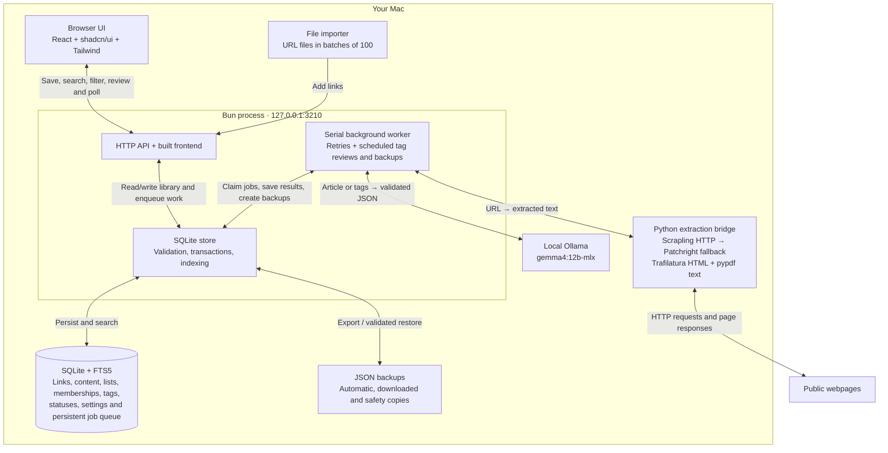

# Braindump

A private link library that runs on your Mac. Built with **Bun, React, shadcn/ui, SQLite, and Ollama**.

Paste a list of URLs, let your local model summarize and tag the pages, and find them again by searching your saved content. The interface includes a reading panel, independent read/like/archive/Trash filters, named lists, editable tags, reviewable tag merges, and complete backup/restore.

## Architecture



Links are saved before extraction starts. The worker processes the persistent queue while the app is running; summaries, tags and full-text search stay local. In development, Vite serves the UI on port 5173 and proxies API requests to Bun on port 3210. See [the architecture guide](docs/architecture.md) for the detailed data and processing contracts.

## Run locally

Prerequisites: [Bun](https://bun.sh), [uv](https://docs.astral.sh/uv/), and [Ollama](https://ollama.com/download). The default model is selected for this M4 Pro Mac with 24 GB of unified memory.

```sh
bun install --frozen-lockfile
ollama serve
```

Keep Ollama running, then in another terminal:

```sh
bun run setup
bun run dev
```

Open [the development app](http://127.0.0.1:5173). `setup` creates an isolated Python 3.13 environment, installs the pinned extractor dependencies and an isolated Chromium download, and pulls `gemma4:12b-mlx`. It can be rerun safely. If the Ollama desktop app is already serving, you do not need another `ollama serve` process.

For everyday use without the development server:

```sh
bun run build
bun start
```

Open [Braindump locally](http://127.0.0.1:3210). Keep this terminal running; Ctrl-C stops the app. Only one app server should use a given data directory at a time. Both modes bind to loopback, not your LAN.

Optional configuration lives in `.env` (copy `.env.example`). Bun reads it automatically. Settings chosen in the app are persisted in SQLite and take precedence over the initial model and schedule defaults in the environment. `DATA_DIR`, `PORT`, `OLLAMA_URL`, and `OLLAMA_CONTEXT` remain environment configuration. The Vite development proxy expects API port 3210; change `vite.config.ts` if changing that port for development.

## Using the library

To import your own newline-separated URL file, replace the example path below with your file's path:

```sh
bun run import /path/to/urls.txt --dry-run
bun run import /path/to/urls.txt
```

The app must be running for the import. The importer validates every line, removes normalized duplicates, saves a safety backup, and submits batches of 100 to the local API. It is safe to rerun: already-saved links are skipped. URLs are immediately available in the library; extraction and analysis continue in the background. A large dataset can take hours, especially when sites need browser fallback or retries.

- **Add links:** paste one or up to 100 URLs. Tracking parameters and fragments are removed; exact normalized duplicates are skipped, including links already in Trash. Other query parameters are preserved.
- **Lists:** open Lists in the sidebar to create, rename, open or delete a named collection. Use the folder button on a card or row, or the reader's Manage → Lists section, to add/remove the link in any number of lists. You can create a list there too. Add Links also offers a destination list and adds existing duplicates to it without changing their statuses. Opening a list includes Archive and excludes Trash; its count follows those same rules. The list filter combines with search, tags and status filters in either layout. Reanalysis never changes lists. Deleting a list removes only the collection, leaving its saved links intact. Names retain your casing, with equivalent case/whitespace names treated as duplicates.
- **Cards or list:** use the Cards / List toggle beside sorting. List view shows compact rows with URLs, summary previews, tags, processing status, and the same read/like/archive/Trash actions. Switching keeps the current search, filters, sort order and loaded links. Your browser remembers the layout; this display preference is not included in library backups.
- **Refresh:** the current sidebar page, search, tag/list/status filters, sort order and expanded Filters panel survive a refresh in the same tab. Queue search and page number are remembered too. Results reload from the top; open readers, edit forms and confirmation dialogs close. Each tab keeps its own view in browser session storage, separate from library backups. If browser storage is unavailable, navigation still works but refresh starts at All Links.
- **Dark mode:** use the sun/moon button next to Add Links, or choose Light, Dark or System under Settings & Backups → Appearance. System is the default and follows your device. Your browser remembers the choice and shares changes with other open Braindump tabs. Appearance is a browser preference, so library backups do not include it.
- **Infinite scrolling:** more links load automatically as you approach the bottom, in batches of 30. The footer shows how many are loaded and offers a keyboard-accessible Load more button. Search, filter and sort changes start a fresh list; background updates preserve the loaded range. Failed loads keep existing links visible and offer Retry.
- **Titles:** page headings match their sidebar navigation labels, including during searches or list filtering; search terms and list names appear below the heading. The app's headings, navigation, dialog titles and form labels use English title case. Imported link titles retain their original casing everywhere, including cards, lists, the reader and queue. Source titles, tag values, URLs, search data and backups keep their original text.
- **Site icons:** cards and list rows show the site's favicon, with a globe when it is unavailable. The local app fetches icons directly from the saved site's origin or its declared icon host, without a third-party favicon service. Existing links work immediately without reprocessing. Icons are cached separately from library data and are fetched again as needed after restart or restore.
- **Read, like, archive, delete:** each flag is independent. Sidebar views provide defaults; Filters can override each flag, including searches across Archive and Trash. Deletion is reversible soft deletion. There is no automatic emptying of Trash.
- **Empty Trash:** open Trash and choose **Empty Trash**. The confirmation shows the total across all search/filter results. **Delete Permanently** removes those links, their list memberships and processing jobs after saving a `before-empty-trash` backup in `data/backups/`. Lists and other links are preserved. If Trash changes or one of its links is still processing, review it again before continuing. There is no Undo; recovery uses the full-library restore in Settings & Backups. A permanently removed URL can be saved again.
- **Search:** SQLite FTS5 searches titles, URLs, summaries, article text, and tags, with case-insensitive word prefixes. Multiple words must all match. This is lexical full-text search, not semantic embedding search. Results are paginated in groups of 30.
- **Reader:** open a link title in either layout for its summary, takeaways, and saved article. Opening a link does not silently change its read status.
- **Queue:** open Queue in the sidebar to see the running job and all waiting jobs, with search, pagination, extraction/model stages, and retry details. **Move to top** makes a waiting item run next after the current job finishes. It also makes a delayed retry eligible immediately, without resetting its attempt count. Priority survives app restarts. This view covers Braindump jobs, not work other applications send to Ollama.
- **Reprocess:** under Manage, reanalyze saved text or re-fetch the latest page and analyze it. Existing summaries remain visible until the replacement succeeds. Analysis replaces the tags; read/like/archive/Trash flags are preserved.
- **Correct a URL:** in Manage, edit **Page URL** and choose **Update URL & re-fetch**. A safety backup preserves the old record before replacing its text, summary and tags. The link keeps its identity, statuses and lists. Already-saved destinations are rejected so two records are never silently merged.
- **Needs attention:** the sidebar count and view collect links whose processing has stopped with an error, including archived links and excluding Trash by default. Search, tags, status filters, sorting and both layouts work here. Cards and rows show an error preview; **Review & retry** opens Manage with the full error and controls to re-fetch, reanalyze or paste article text. Queuing a retry removes the link from this view; jobs still retrying automatically remain in Queue.
- **Blocked pages:** Manage also accepts pasted article text (at least 180 characters). This replaces saved text and queues analysis.
- **Tags:** scheduled or on-demand jobs suggest spelling variants and synonymous tags. You review each merge. Manual merging/renaming is also available. Accepted aliases apply to all links, including Archive and Trash, and to future generated tags. A backup is saved before merging.
- **Shortcuts:** `/` focuses search; `n` opens Add links when you are not typing.

## Extraction approach and limits

Extraction stays on your machine. A small Python bridge uses **Scrapling 0.4.15** and **Trafilatura 2.2.0**:

1. Chrome TLS/browser impersonation through Scrapling's curl-based HTTP fetcher.
2. If the page is blocked, too short, or needs JavaScript, a fresh isolated **Patchright Chromium** session uses Scrapling's stealth fetcher and Cloudflare challenge support.
3. Trafilatura tries precise article extraction, then standard and recall modes for short landing pages and directories. When only a useful public description is available, the saved content explicitly labels it as a metadata-only website overview. Challenge and login responses are rejected. HTTP and explicit HTML refresh redirects are followed within a bounded, public-address-checked chain.
4. [pypdf](https://pypdf.readthedocs.io/en/stable/user/extract-text.html) extracts text layers from PDFs locally, with page markers. PDF input is limited to 20 MB, 500 pages, 8 MB of decoded content per page and one million text characters. HTML retains its 8 MB limit. Binary data is rejected before inference, including previously saved raw PDF data; use Re-fetch page to replace it with readable text.

Cards and lists label metadata-only results **Description only**. The reader explains that these summaries do not cover the full page or video, independently of the model's wording. Short but useful published descriptions can qualify without a full article; their saved text includes the original page title and source URL, and inference stays limited to the supplied description.

Hard CAPTCHAs, login-only pages, subscription access, site changes, IP reputation checks and some non-article pages may still fail. Extraction does not use paid proxy services, remote extraction APIs or personal browser cookies. Scanned/encrypted PDFs and video transcription are not supported; a video's public description is not its transcript. Successful extraction may reflect a directory, website description or only the publicly visible portion of an article. Use the original link and the pasted-text fallback when needed.

HTTP redirects and browser requests are checked against public-network destinations; local/private addresses and nonstandard web ports are rejected. The local API rejects foreign origins and accepts JSON mutations only. This is a single-user local app, not an authenticated network service. Do not expose its port publicly. Source text is treated as untrusted data in prompts and rendered as plain text, never executable HTML.

Sources checked 9 September 2026: [Scrapling](https://github.com/D4Vinci/Scrapling), [stealth fetcher documentation](https://scrapling.readthedocs.io/en/latest/fetching/stealthy.html), [Trafilatura](https://trafilatura.readthedocs.io/en/latest/).

## Local model choice

The default **`gemma4:12b-mlx`** is already installed on this machine and uses Ollama's Apple Silicon MLX runtime. The [Ollama catalog](https://ollama.com/library/gemma4:12b-mlx) lists a roughly 7.7 GB model. This is a practical current model choice for the machine, not a claim of a measured universal summarization benchmark win. The [26B model](https://ollama.com/library/gemma4) is roughly 18–19 GB before runtime/context overhead, making it a tighter fit alongside other apps on a 24 GB Mac.

Inference uses a 16K context, disabled thinking, validated [structured JSON output](https://docs.ollama.com/capabilities/structured-outputs), and one model job at a time. Long articles are split into bounded sections and combined through hierarchical summarization instead of silently truncating the end. Completed sections are checkpointed locally so retries and restarts resume progress; changing the source or model invalidates those checkpoints. The final output contains a short summary, factual takeaways, and topic tags. AI output can still be inaccurate; check the original for important claims.

Change the model in Settings after pulling another local model. For non-Apple-Silicon hosts, set `OLLAMA_MODEL=gemma4:12b` before setup. Cloud model names and non-loopback Ollama endpoints are rejected. The app sends webpage requests to the sites you save; it sends article text only to local Ollama.

## Jobs and recovery

Eligible jobs run in priority order, then their original insertion order. Promoting a job gives it the highest priority; the most recently promoted job runs next. Running jobs are never interrupted by promotion. The queue refreshes every three seconds and displays 50 waiting jobs per page; search keeps each result's position in the overall queue visible.

Existing databases upgrade automatically to schema version 3: version 2 added queue priority with a default of zero; version 3 adds lists and their memberships. Existing links, job IDs and retry information are retained. JSON backup format version 2 includes lists and memberships and still accepts version 1 backups. Job history and queue priorities are not exported, and restored incomplete links receive a fresh queue order.

SQLite stores the job queue. Jobs run serially, retry up to three attempts with backoff, and return interrupted work to the queue after a restart. Unavailable Ollama pauses dispatch for 30 seconds without consuming an attempt; queued work resumes automatically when it returns. Once extraction succeeds, retries continue with saved text. Extraction has a 150-second process deadline, and each model request has a 5-minute timeout. Tag reviews use spelling heuristics plus model suggestions; large vocabularies are batched against the most common tags, so a review is not an exhaustive all-pairs comparison. Errors are visible in each link and in Settings.

If Ollama reports an `expected a structural tag` format error after an update, fully restart Ollama so its server and runner use the same installed version, then reanalyze saved text. The app sends the documented public JSON schema format; internal runner formats belong to Ollama.

Scheduled tag review and automatic backups default to every 24 hours **while the server is running**. Overdue work runs at the next start. Set an interval to 0 to disable that schedule. On-demand review remains available. This is an in-process scheduler; nothing runs while the app is stopped.

## Backup and restore

The default live database is `data/braindump.sqlite`, with SQLite WAL sidecars. **Use Download backup** for a consistent portable JSON snapshot. It includes full text, all statuses, lists and memberships, tags, accepted aliases, merge-review history, and settings. Running job history is not backed up; interrupted links are requeued on restore. Older version 1 backups are supported but contain no lists, so restoring one replaces current lists with an empty set; the safety snapshot preserves them.

Automatic snapshots are stored in `data/backups/`, retaining the latest 14 automatic copies. A restore validates the version and every record before replacing the library in one transaction. It first writes a `before-restore-*.json` safety snapshot. Invalid input or a transaction failure leaves the current library intact. Restore is blocked while a job is actively running. The upload limit is 256 MB. Safety snapshots are not automatically pruned.

Settings & Backups → Backup & Restore lists **Available Backups** from `data/backups/`, newest first, with filenames, last-modified dates and sizes. Use a row's **Download** to save that snapshot elsewhere, or **Restore** to validate it and review its link/list counts before confirming replacement. Refresh reloads the list; it also updates periodically and after restoration. Show more reveals older snapshots. The existing Restore backup button still accepts a file from your computer. No backup is restored merely by listing or selecting it.

To undo a restore, merge or emptied Trash, select the corresponding safety snapshot in Available Backups. These are unencrypted backups containing full article text. Copy downloaded backups to another disk/location if you want protection against drive failure; automatic copies on the same disk do not provide that.

`data/`, `.browsers/`, `.env`, and the Python virtual environment are ignored by Git. Do not copy only the `.sqlite` file while the server is running; use the JSON export, or stop the server before copying the entire data directory.

## Verification

```sh
bun install --frozen-lockfile
uv sync --locked --project scraper --python 3.13
bun run verify    # complete automated code, test, documentation and build gate
bun run test:live # opt-in real extraction + local Ollama + restore/search
```

`verify` uses the same checks as CI and needs no running app, Ollama or Chromium. It checks formatting, TypeScript/React/accessibility and Python lint, local documentation links and anchors, Mermaid syntax, isolated tests, dependency lockfiles, repository conventions and the production build. See [the engineering standards](docs/standards.md) for enforced rules and required review evidence.

The live check uses a temporary database and does not add test links to your library. It requires completed setup and running Ollama.

## Making changes

Start with [CONTRIBUTING.md](CONTRIBUTING.md) and [the engineering standards](docs/standards.md) for the contribution workflow and verified conventions. [AGENTS.md](AGENTS.md) covers agent guidance and live-data safety; [the architecture guide](docs/architecture.md) maps implementation contracts. Keep the affected documents current alongside code changes.

## Project structure

```text
src/                  React interface and shadcn/ui components
public/               Static assets, including the app favicon
server/               Bun API, SQLite store, queue, Ollama integration
scraper/              Isolated Scrapling/Trafilatura extractor and uv lockfile
scripts/              Setup, development runner, standards gate and live check
tests/                Isolated library, API, parser and standards regression tests
docs/                 Implementation context for contributors and agents
data/                 Your local database and backups (ignored)
```
