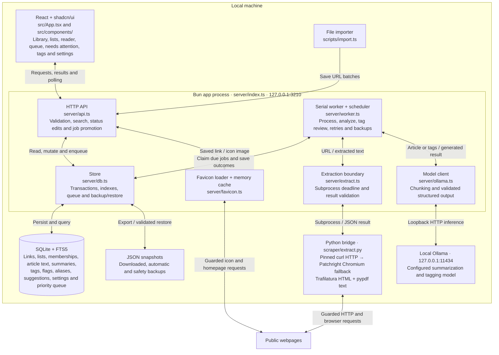

# Braindump implementation context

Read [AGENTS.md](../AGENTS.md) for change rules and [README.md](../README.md) for setup and user workflows. This document explains the current code; defaults and limits remain defined by the source files named below.

## Runtime and file map

The production process is a Bun HTTP server serving the Vite build and `/api/*`. A single in-process worker drains a SQLite queue. Extraction runs in a short-lived Python subprocess, and inference calls the local Ollama HTTP service. Development adds Vite's frontend server and API proxy; it does not add another worker service.

Links are saved and queued before extraction or inference begins. The worker persists results and failures through the store; the UI polls the API to display progress and links needing attention. Reanalysis uses saved text without fetching the page again. Article text, inference and library storage stay local; extraction requests go to the saved websites.

| Area                      | Entry points and responsibilities                                                                                                                              |
| ------------------------- | -------------------------------------------------------------------------------------------------------------------------------------------------------------- |
| Startup and configuration | `server/index.ts` binds the port before initializing storage; `server/config.ts` resolves environment defaults                                                 |
| HTTP API                  | `server/api.ts` validates request boundaries, dispatches CRUD/filter/queue/tag/settings/backup operations                                                      |
| Stored/API contracts      | `server/schema.ts` owns Zod schemas and inferred types; `server/queue-types.ts` defines queue response types; `src/types.ts` adds frontend response types      |
| Persistence               | `server/db.ts` owns SQLite schema, transactions, FTS, queue persistence, aliases, snapshots and restore                                                        |
| Jobs and schedules        | `server/worker.ts` runs extraction/analysis/tag-review jobs and due automatic backups                                                                          |
| Inference                 | `server/ollama.ts` checks local connectivity, requests structured JSON, validates output, and summarizes long articles in sections                             |
| Extraction boundary       | `server/extract.ts` launches and bounds the Python process; `scraper/transport.py` pins/bounds networking; `scraper/extract.py` handles extraction             |
| Main UI                   | `src/App.tsx` owns navigation, filters, pagination, polling and modal selection                                                                                |
| Workflows                 | `src/components/{AddLinks,LinkCard,Reader,ListsPage,ListMembershipEditor,TagsPage,SettingsPage,QueuePage}.tsx` compose shadcn primitives                       |
| UI foundation             | `src/components/ui/`, `src/index.css`, `src/lib/api.ts`, `src/lib/utils.ts`                                                                                    |
| Branding/static files     | `index.html` declares metadata and the favicon; Vite copies `public/` assets to `dist/`                                                                        |
| Setup and operations      | `scripts/setup.ts`, `scripts/dev.ts`, `scripts/import.ts`                                                                                                      |
| Verification              | `tests/store.test.ts` and `tests/queue.test.ts` use isolated temporary stores; `scripts/check-live.ts` exercises real extraction/inference with temporary data |

## Data and invariants

SQLite uses WAL, foreign keys and a busy timeout. `links` stores a stable UUID, a unique normalized URL, and the full JSON link record. The record includes source text, generated summary/highlights/tags, four independent boolean user statuses, processing state/error, timestamps, extraction method and model provenance.

`tags` and `link_tags` provide tag filtering; the FTS5 `search` table indexes title, URL, summary, content and tag text. These are maintained by `Store.save()` in the same transaction as the link record. Updating only `links.data` directly would leave searches and tag filters stale. `tags` can retain unused names; visible tag counts come from link relations and exclude Trash.

FTS input is converted into quoted word-prefix terms joined with AND, using bound SQL parameters. The list endpoint returns 30 records per page without full article content; the detail endpoint returns the complete record. Sidebar defaults live in the frontend: `/api/links` itself does not automatically exclude Archive or Trash unless those query filters are provided.

The Cards / List toggle in `src/App.tsx` changes presentation only. Both layouts render `LinkCard` with the same data, reader callback, tag filtering, and shared status/action controls. `LibraryLayout` is a frontend type; the chosen value is saved under `braindump.libraryLayout` in browser local storage, with Cards as the fallback if storage is unavailable or invalid. Switching layouts must preserve search, filters, sorting and loaded links without refetching or changing library records. The preference is specific to the browser origin and is not part of SQLite or JSON backups. List styling in `src/index.css` uses the list container width to place actions alongside content on desktop and below it on narrow screens.

`src/lib/view-state.ts` validates the current sidebar page, raw search input, explicit tag/list/status filters, sort, expanded Filters panel and queue search/page in `braindump.view.v1` session storage. `App` initializes these before the first library request, including the debounced search value, then saves changes. Keeping explicit status overrides separate from sidebar defaults preserves Archive/Trash/Needs attention behavior. A successful lists refresh clears a missing list filter; a failed refresh leaves it intact. Queue state is owned by `App` so navigation and reload retain it, with pagination reset only when search changes and clamped by the API as jobs leave the queue. Malformed fields fall back individually, and blocked storage never prevents navigation. This per-tab browsing state is separate from SQLite, backups and the shared local-storage theme/layout preferences. Reload starts with fresh results at the top; loaded depth, reader selection, unsaved edits and confirmation dialogs are not restored. `tests/view-state.test.ts` covers storage validation and isolated React reload/request behavior.

The library replaces page navigation with infinite scrolling. `src/lib/use-library-feed.ts` connects a query-specific `LibraryFeed` to React and polls four seconds after each completed refresh. `src/lib/library-feed.ts` loads one 30-record API page at a time, serializes loading and refresh work, and deduplicates link IDs. Refreshes fetch the entire loaded range sequentially and replace it together, preserving loaded depth while repairing boundaries moved by edits or new links. Failed requests leave the previous list intact; failed appends require an explicit retry. Cancelling a query aborts its request and invalidates late responses even if the transport ignores cancellation.

`src/App.tsx` observes the footer with a 600-pixel margin to load before the reader reaches the end. A Load more button works with a keyboard or when IntersectionObserver is unavailable; loading, failure and end-of-results states remain visible. Search, filters, sort and library-view changes create a fresh feed and return to the top. Layout changes preserve the current feed. The Queue screen retains its separate job pagination. Loaded records remain in the DOM until the query changes; this is incremental loading, not list virtualization. `tests/library-feed.test.ts` covers concurrency, cancellation, failures, duplicate boundaries, shrinking results and loaded-range refreshes using isolated stores.

`LinkCard`, `Reader` and `QueuePage` display saved link titles verbatim, including queue promotion labels and notifications. Page headings match their sidebar navigation labels. Library headings use the navigation entry's `name`, including during search and list filtering; search terms and the unchanged list name stay in the subtitle. App-owned page, section, dialog, navigation, form-label, browser-tab and empty/error titles are authored in English title case; body copy remains sentence case. Tag values quoted in merge-dialog titles retain their original casing. No display transformation changes imported content, SQLite records, API responses, FTS or backups. Browser review checks both app-title casing and preservation of source titles. The `.gitignore` exception for `/src/lib/` is required because the generic Python template otherwise ignores application helpers.

Appearance is a browser preference under `braindump.theme`, independent of SQLite and backups. `public/theme.js` runs synchronously from the HTML head to resolve Light/Dark/System before the stylesheet paints; it falls back to the device preference if storage is unavailable and removes invalid saved choices. `AppearanceProvider` in `src/components/Appearance.tsx` wraps the app in `src/main.tsx` and uses the existing `next-themes` dependency for system changes, persistence and synchronization across tabs. The provider's redundant inline bootstrap is an inert `text/plain` script, leaving initialization to the external HTML-head script and preserving `script-src 'self'` without an inline-script allowance. This also avoids React 19.3's warning about executable scripts rendered by client components. That component also supplies the topbar toggle and settings selector. Shared CSS tokens define both palettes, the class-based Tailwind dark variant matches the provider, native controls receive the matching `color-scheme`, and the shadcn Sonner wrapper follows the theme. `tests/theme.test.ts` checks pre-paint choices, storage fallbacks and base text/status contrast. Its isolated Happy DOM subprocess exercises theme controls, system changes, storage events and the inert provider script without live services; this does not replace desktop/mobile visual checks.

`aliases` maps merged tag names to canonical names. `Store.canonical()` resolves chains and detects cycles. Saving any link applies aliases, which prevents a later model run from reviving an old spelling. Merges affect archived and deleted links too. `suggestions` retains pending, accepted and dismissed merge pairs; an identical dismissed pair is not reinserted by the next review.

`meta` stores settings and schedule timestamps. Initial defaults come from `.env`/`server/config.ts`; persisted model and interval settings take precedence. The database uses `PRAGMA user_version=3`, while JSON exports separately declare `format: "braindump", version: 2`. The store constructor transactionally upgrades v1 databases by adding `jobs.priority` with a zero default and a dispatch index, then upgrades v2 databases with the list tables and membership index. Existing job order and records are preserved; databases from a newer version are rejected before schema initialization or job recovery. Extend this version-gated migration path for future changes rather than resetting the database or unconditionally changing its version.

The reader keys its stateful component by selected link ID. Pending PATCH, reanalysis reloads and polling responses for an old selection cannot set state in a newly opened reader. `tests/reader.test.ts` exercises delayed status and reanalysis mutations followed by selection changes, preserving the source title and the next action target.

## Emptying Trash

`EmptyTrash.tsx` adds a confirmed action to the Trash heading, independent of its search, filters, loaded pages or card/list layout. `GET /api/trash` returns the total count, running-link count and a SHA-256 token of the sorted trashed link IDs. `POST /api/trash/empty` validates `{token}` with `emptyTrashSchema`, then `Store.emptyTrash()` rechecks the exact set inside a synchronous transaction. A changed set or a running job for a trashed link returns HTTP 409; unrelated running jobs are allowed. This prevents stale confirmations and in-flight processing from deleting or recreating the wrong records. The dialog initially focuses Cancel and requires fresh review after an error.

A `before-empty-trash` JSON safety snapshot must succeed before deletion. The transaction removes matching FTS records and analysis checkpoints, then deletes the links; foreign keys cascade to link tags, list memberships and all associated jobs. Lists, other links, accepted aliases, suggestions and settings remain intact. Any database failure rolls back the deletion. Empty Trash is a no-op; deleted URLs may be imported again. No schema or backup-version change is needed. There is no per-link Undo after permanent deletion; recovery uses the full-library backup restore. The frontend refreshes the loaded feed, counts, lists and tags together through the existing revision mechanism. `tests/trash.test.ts` covers deletion beyond one page, indexes/cascades, backup recovery/failure, rollback, stale confirmations, running jobs and API boundaries.

## Lists and memberships

`lists` stores a stable UUID, display name, unique normalized name key and creation timestamp. Names use NFC Unicode normalization, trimmed/collapsed whitespace, 1–80 characters and no control characters. The display keeps user casing; the unique key is lowercase. `list_links` joins lists to links with a composite primary key and cascading foreign keys, plus a reverse lookup index. Membership lives outside the link JSON, so worker updates, tag merges and status edits cannot overwrite it. Trash retains memberships. Deleting a list cascades only to its membership rows, never to links.

| Endpoint                                  | Contract                                                                                     |
| ----------------------------------------- | -------------------------------------------------------------------------------------------- |
| `GET /api/lists`                          | Named lists, sorted by normalized name, with counts including Archive and excluding Trash    |
| `POST /api/lists`                         | Create `{name}`; optional `linkId` creates the list and adds that link in one transaction    |
| `PATCH /api/lists/:id`                    | Rename with `{name}`; equivalent case/whitespace names conflict with HTTP 409                |
| `DELETE /api/lists/:id`                   | Delete the list and its memberships; saved links remain                                      |
| `GET /api/links/:id/lists`                | Return `listIds` for the link, including when it is in Trash                                 |
| `PUT /api/lists/:listId/links/:linkId`    | Add one membership idempotently                                                              |
| `DELETE /api/lists/:listId/links/:linkId` | Remove one membership idempotently                                                           |
| `GET /api/links?list=:id`                 | Combine a list with search, tag, status and sort parameters using the normal 30-record pages |

All mutations retain the existing local-origin/JSON boundary. Missing lists/links return 404; malformed path UUIDs and payloads return 400. `POST /api/links` also accepts optional `listId`: the entire URL batch and memberships are saved atomically, including memberships for already-saved URLs, without changing duplicate link statuses or queueing duplicate work. List names are not added to the article FTS index; use the list filter to scope search.

`ListsPage` manages collections and opens their links with Archive included and Trash excluded, matching displayed counts. The library list selector instead preserves the current view's other filters. Both card and row layouts expose the same folder action; that dialog and Reader → Manage share `ListMembershipEditor`. It loads memberships on opening, saves individual checkbox changes, and can create and assign a new list atomically. It reports failed writes without claiming they saved. `AddLinks` offers a destination list, initially the active list filter. List mutations refresh library data and counts; changing filters uses the existing feed cancellation/reset behavior. These are persisted collections, separate from the Cards / List presentation preference.

`tests/lists.test.ts` covers migration/reopen, name conflicts, status/reanalysis preservation, combined filters across pages, API operations, duplicate imports, backup compatibility and restore rollback. An isolated Happy DOM subprocess exercises membership edits, failed saves, creation and switching links against a temporary store without starting a worker or contacting websites/Ollama.

## Save and processing flow

The Needs attention sidebar view uses the existing list filter `state=error`, with Archive included and Trash excluded by default. `Store.counts().attention` counts non-deleted links in that state, independent of read/like/archive flags. Search, tag/status filters, sorting and pagination still run on the server; the view keeps its error-state constraint while other library views retain the Processing selector. Automatic retries are `queued` and belong in Queue. A manual retry clears the error and queues work through the existing API, so the item leaves Needs attention until another terminal failure. `LinkCard` shows error previews in this view for both layouts. Failed links open the reader on Manage with full error details and existing recovery controls. No stored fields or backup/schema versions change.

1. `POST /api/links` parses up to 100 URLs. Normalization removes fragments and known tracking parameters while retaining other query parameters. A link already in Trash is still a duplicate.
2. `Store.add()` saves the initial record and queues a `process` job atomically. Saving does not wait for network or model work.
3. The worker claims a due job ordered by `priority DESC, id ASC` and increments its attempt count in a transaction. The partial unique index deduplicates active jobs of the same kind/link; the API also rejects simultaneous reprocessing requests of different kinds for a link.
4. `process` changes the link to `extracting`, then saves extracted text/metadata and converts the job to `analyze` in one transaction. This persisted stage transition prevents a retry or restart from fetching successful extraction again. `analyze` uses saved text. Both store the validated model result only after success.
5. The current record is re-read for updates after asynchronous work. Prior summaries remain available until replacement succeeds, and user status edits survive processing.
6. A failure records an error and retries with backoff, up to three attempts. Exhaustion leaves the job `failed` and the link `error`. Restarts requeue `running` jobs.

Link states (`queued`, `extracting`, `summarizing`, `ready`, `error`) and job states (`queued`, `running`, `done`, `failed`) serve different purposes. A queued job for a deleted link is skipped. Restoring an unfinished link from Trash queues its missing work again. Deleting an already-running link is not cancellation; its result may finish while the deleted flag remains set.

The worker is serial within one process, not protected by a distributed lease. Do not open a second `Store`/worker on live data. Backlog counts in `queueStatus()` are separate from the most recent 50 jobs shown in activity history.

### Queue inspection and promotion

`GET /api/queue?page=1&q=...` returns running jobs separately from a searchable, paginated waiting list, plus model information and the worker's current stage/start time. It does not return full article text. The waiting list includes all three job kinds, excludes queued links in Trash, and displays due jobs before delayed retries. Positions are computed before filtering so search results keep their overall queue position. Pending order can change as retry deadlines pass.

`POST /api/queue/:id/promote` transactionally gives a queued job a priority above every active job and clears `available_at`, making delayed retries immediately eligible. It preserves job IDs, attempt counts, errors, link contents and user flags. Running or finished jobs and links in Trash return a conflict; stale IDs return not found. No in-flight model request is cancelled. The frontend disables repeated clicks while a promotion is pending and refreshes the first queue page afterward.

`Worker.current` is transient display metadata for the active job, including the actual model selected for the current inference stage. Dispatch still comes from SQLite; refreshing the UI does not claim work. Priority survives restart, but JSON backup/restore does not preserve job history or priority because incomplete links are requeued from their stored records. The Queue screen describes Braindump's own worker, not Ollama's global workload.

Schedules are checked by the worker between jobs. Due tag reviews enter the same queue; due backups create snapshots. Long jobs and large imports can delay both. There is no OS scheduler or service running after the app exits.

## Extraction and model contracts

### Site favicons

`SiteIcon` is shared by cards and list rows and lazily requests `GET /api/links/:id/favicon`. The API accepts only saved link IDs and retains the same local-origin checks. `server/favicon.ts` tries the origin's `/favicon.ico`, then up to three icons declared in the homepage head, resolving redirects and the first HTML base URL. Bun's HTMLRewriter parses declarations; `entities` decodes HTML attributes. A neutral globe is returned when no supported image can be fetched, and the React component also handles connection/decode failures.

Icon requests run independently of article/model jobs, with six concurrent lookups and at most 32 pending origins. A bounded memory cache holds 128 origins: successful images for 24 hours and misses for one hour. Each lookup has a 10-second network deadline, at most three redirects per resource, 256 KiB per image and 512 KiB per homepage. HTTP(S), standard ports, public literal addresses and DNS results are checked before connections; the checked DNS results are used for the actual socket. No browser cookies or third-party favicon lookup service are used. Image types are identified from their bytes; HTML responses are rejected. Returned images have `nosniff`, same-origin resource policy and a sandboxed CSP, including for SVGs. These disposable caches do not alter link records, processing status, queues or JSON backups.

### Article extraction and inference

The Python bridge uses its own uv-managed environment and the project-local `.browsers/` Chromium installation. `scraper/transport.py` owns HTTP and browser networking. Its `curl-cffi` transport impersonates Chrome, validates every DNS answer as public and pins those exact addresses with [CURLOPT_RESOLVE](https://curl.se/libcurl/c/CURLOPT_RESOLVE.html). Each request has a fresh handle, automatic redirects and environment proxies are disabled, and TLS still verifies the URL hostname. Header/body callbacks enforce 64 KB headers and 8 MB HTML/resource or 20 MB PDF decoded bodies during transfer, avoiding an unbounded streaming producer queue. Requests have 10-second connection and 25-second total deadlines.

If HTTP fails or yields insufficient/challenge text, a fresh Scrapling/Patchright session renders JavaScript. Every intercepted request is fulfilled from the same bounded transport; never use `route.continue_()` or `route.fetch()` here. [Browser routing does not intercept every redirected request or service-worker request](https://playwright.dev/python/docs/api/class-browsercontext#browser-context-route). Main-document HTTP redirects therefore finish locally, retain response cookies, and navigate afresh in the same isolated session, up to eight requests in the chain. Subresource redirects are followed explicitly with destination validation and credential removal across origins. A deny-only loopback proxy blocks all network traffic outside interception, with Chromium's implicit loopback bypass disabled. Service workers, WebSockets, QUIC, images, fonts and media are disabled. The browser budget is 100 requests and 40 MB decoded response bytes per extraction. These restrictions can limit site compatibility; pasted text remains supported.

Trafilatura selects readable text and metadata. `scraper/tests/test_transport.py` exercises real pinned libcurl sockets, environment-proxy isolation, redirects and streaming/decompression limits using temporary local servers. `bun run test:browser` additionally launches actual Chromium to check allowed navigation and blocked private/bypass traffic. It is opt-in and separate from the default browser-free suite.

The bridge returns JSON with `title`, `description`, `content`, and `method`, or an `error`. Diagnostics belong on stderr. `server/extract.ts` validates the result and enforces the overall subprocess deadline. HTML extraction tries precision, standard, then recall, requiring readable text and rejecting challenge/login pages. A useful public metadata description is a last fallback, labeled in both the saved text and the `*-metadata` method. It never represents a full article or transcript. Explicit HTML refresh targets share the eight-hop HTTP redirect limit and destination validation.

Error headings are rejected before broader extraction can turn navigation into a summary. Reddit post URLs require the matching post container and its own text body; removed posts, comments and adverts cannot substitute for the requested post. Unsupported/removed content remains visible as an error.

`*-metadata` provenance drives a Description only label in both link layouts and an explanation in the reader. This disclosure is independent of model-generated wording and persists through backups in the existing `method` field. Descriptions are checked independently of their title/URL: at least 80 characters and 10 words (or the existing CJK prose allowance), with the same text-quality and login/challenge rejection. Normal article text still requires 180 characters and 15 words. Metadata content includes its disclosure, original title, source URL and description; that context cannot qualify an otherwise insufficient description. Short-description prompts ask for a brief summary and only one or two supported highlights.

PDF MIME/signature detection runs before HTML parsing. pypdf extracts text locally with page markers; encrypted or image-only documents fail with a specific paste/OCR instruction. Bounds are 20 MB input, 500 pages, 8 MB decoded page content, one million output characters and the existing subprocess deadline. pypdf's scoped decoder configuration enforces stream expansion limits before `get_contents()` or `get_data()` allocates decoded content. HTML retains its 8 MB limit. Other binary formats are rejected. The analysis boundary also rejects binary saved/pasted text, preventing older malformed extractions from reaching Ollama. Video transcription and OCR are not implemented.

Ollama requests use JSON schema derived from the Zod input schema, disabled thinking, and local-only model/endpoint checks. The response is parsed and validated again. Prompts treat articles and tag names as untrusted data. The model has no tools or authority to execute source-page instructions.

Long text is split into bounded character chunks, summarized per chunk, and reduced in groups until one summary remains. Completed chunks and reduction steps are validated and checkpointed in `meta` under `analysis:<link ID>`. A SHA-256 fingerprint covers source content/title, model, context, prompt/schema and checkpoint version; mismatches invalidate prior work. Existing tags are advisory vocabulary, so vocabulary growth does not invalidate a partial summary. Checkpoints survive retries/restarts, are removed after success or URL replacement, and are excluded from JSON backups; restore clears them with other runtime metadata (preserving the installation backup folder). Chunk size is a character heuristic, not an exact token count. If changing chunking/reduction algorithms, bump the checkpoint version. Do not silently drop the end of an article. A model-setting change affects subsequent jobs and does not automatically rewrite all existing summaries.

Before extraction/inference, the worker checks local Ollama availability. Unavailability or connection loss defers work and dispatch for 30 seconds without consuming a retry attempt; ordinary model/parse/timeouts still exhaust the three-attempt budget. Waiting work stays in Queue, not Needs attention. The persisted `ollamaRetryAt` deadline prevents polling every queued item against an offline service.

`POST /api/links/:id/repair-url` accepts a normalized public HTTP(S) `url`. It rejects active jobs, Trash, unchanged URLs and existing destinations. After validation it saves a safety backup, then transactionally replaces source metadata/content/generated results and queues fresh extraction. Link ID, creation time, independent statuses and list memberships remain intact. No silent merging or URL guessing occurs in the worker. Manage exposes this operation as Page URL editing.

Tag review combines deterministic spelling candidates with model-suggested synonyms. Larger vocabularies are batched with common tags as shared candidates; this is not an exhaustive comparison of every pair. Suggestions do not mutate links until a merge is accepted.

## Backups, imports and testing data

`server/backup-files.ts` inventories regular JSON files directly under `Store.backupDirectory()`, initially the data directory's `backups/` folder. `GET /api/backups` returns filenames, sizes and filesystem modification times, newest first, without loading article content or modifying the library. `GET /api/backups/:name` downloads the selected file as a no-store JSON attachment. Both retain the API's local-origin checks. Filename/path traversal, symlinks, non-files and downloads over 256 MB are rejected; reads use a no-follow descriptor, a verified size bound and a final change check. Missing/rotated files return a refreshable error. Inventory does not imply that a file's JSON is a valid backup.

`POST /api/backups` accepts an empty JSON object and synchronously creates a `Store.backup("manual")` snapshot, returning its server-generated filename with HTTP 201 only after the file is saved. The normal local-origin/JSON boundaries apply; callers cannot choose paths or prefixes. Snapshot creation does not pause the worker, mutate the library or reset `lastBackup`; synchronous execution produces a consistent snapshot between worker updates. Manual copies are excluded from automatic retention. Settings exposes Create Backup with a pending state, disables conflicting actions, reports write failures inline and refreshes the inventory on success. `tests/backups.test.ts` covers contents, download/restore, retention, scheduling preservation, input boundaries and disk failure.

`GET /api/settings/backup-directory` returns the active absolute folder. `PUT` accepts only `{ directory }`, validates an absolute path or `~/…`, and calls `Store.moveBackups()`. `server/backup-directory.ts` rejects final-directory symlinks, overlapping source/destination folders and filename conflicts. Existing parent aliases are resolved to a canonical path. It copies all inventory-visible regular JSON files through no-follow descriptors with a 1 MB buffer, exclusive creation, private permissions, source-change checks, preserved modification dates and file/directory flushing. This supports different volumes without relying on filesystem rename. Only after every copy succeeds does it persist `meta.backupDirectory`, then delete unchanged originals. Copy/commit failures retain the old setting and roll back new copies; cleanup failures explicitly report leftover paths without deleting the complete destination. Unrelated files and symlinks remain untouched. The synchronous operation serializes with backups and worker updates; large folders can briefly delay other API requests. A process/machine interruption can leave destination copies requiring conflict cleanup on retry; source files are never removed before the setting is committed.

The backup folder is installation metadata, excluded from JSON v1/v2 snapshots. Restore preserves it when replacing `meta`; imported settings cannot redirect filesystem writes. Existing installations fall back to their original folder without a database migration. All manual, scheduled and safety snapshots use this same path. The import CLI now calls `POST /api/backups/before-import` with an empty JSON object before importing, so its local `DATA_DIR` cannot disagree with the running server. `BackupFolder.tsx` provides the path form, pending/error states and cleanup warnings, refreshing Available Backups only on success. `tests/backup-directory.test.ts` covers file integrity, restart/restore compatibility, conflicts, rollback, cleanup failures, request boundaries, retention and the real import CLI against an isolated server.

`SavedBackups.tsx` displays ten rows initially with Show more, manual refresh and 30-second refresh. `SettingsPage.tsx` validates the selected file with the same v1/v2 schema and confirmation used for uploaded backups. It submits the exact reviewed data through the existing `/api/restore` path, retaining running-job protection, pre-restore safety snapshots and transactional replacement. Cancellation, late responses and invalid files must never initiate a restore. The list refreshes after restoration to include the new safety snapshot. `tests/backups.test.ts` covers inventory, exact downloads, v1/v2 restoration, invalid files, size/path/symlink boundaries and preservation of the live-request guards.

Engineering conventions and their enforcement are defined in [standards.md](standards.md). `scripts/verify.ts` is the shared local/CI gate; `scripts/check-repo.ts` checks repository policy and `scripts/check-docs.ts` validates Markdown links/anchors and Mermaid syntax. `tests/standards.test.ts` includes invalid fixtures to prove that these checks reject violations. Offline Python tests live in `scraper/tests/`. Pinned development tools and formatting/lint configuration are part of the repository; none of these checks starts a worker on live data.

Version 2 JSON exports contain links with full text and all statuses, lists (including empty ones), memberships (including Trash), settings, aliases and suggestion history. Job history and scheduler timestamps are omitted. Restore accepts versions 1 and 2; version 1 has no lists, so replacing a library with it removes current lists after creating the safety snapshot. Validation rejects duplicate list IDs/names, duplicate memberships and references to missing lists/links before replacement. Restore also validates URLs, duplicate links and alias cycles, saves a safety copy, then replaces data transactionally and rebuilds derived indexes. Incomplete non-deleted records are requeued. The API takes an exclusive restore lock before awaiting request JSON, blocks concurrent restores and active worker work, and preserves the previous worker pause state in `finally`. Each table deletion runs as a separate statement inside the synchronous restore transaction: Bun can swallow an intermediate failure in a multi-statement `exec`. Any deletion/insertion failure rolls back all tables, FTS indexes and checkpoints; the safety snapshot remains. URL normalization enforces the same 8,192-character limit as backup validation, including encoding expansion. The restore dialog shows list counts and explains the older-backup behavior.

Automatic backups retain 14 rotating copies. Manual backups are not automatically pruned. Safety copies made before import, merge, URL repair, emptying Trash or restore are not automatically pruned. Backups are unencrypted user data. To back up a running library, use the export API; copying only the main SQLite file can omit WAL changes.

The importer accepts user-provided newline-separated URL files. It validates the whole file, deduplicates normalized URLs, makes a safety snapshot, and submits batches to the API. It uses the same `PORT` and local `DATA_DIR` configuration as the server for its destination and backup location. Treat import files as user data and use separate temporary fixtures for tests.

Automated tests use temporary directories and do not require the live library. The opt-in live script also uses temporary data, but still consumes real Ollama resources and makes external page requests. A browser-rendered page, a successful HTTP fetch, validated AI output, a queued job, and a working UI are separate kinds of evidence; report which were actually checked.
